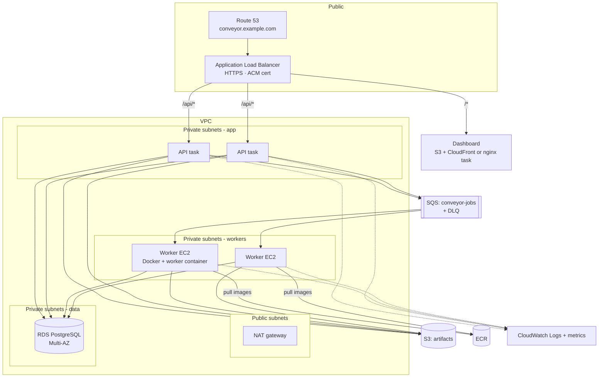

# AWS deployment

This document describes how Conveyor maps onto AWS. The application code already supports the AWS backends, so moving from local to AWS is configuration plus infrastructure:

| Concern | Local | AWS | Switch |
|---|---|---|---|
| Queue | Redis + BullMQ | SQS | `QUEUE_DRIVER=sqs`, `SQS_QUEUE_URL`, `AWS_REGION` |
| Artifacts | Docker volume | S3 | `STORAGE_DRIVER=s3`, `S3_BUCKET` |
| Database | Postgres container | RDS PostgreSQL | `DATABASE_URL` |
| Logs | `docker compose logs` | CloudWatch Logs | JSON logs on stdout via the `awslogs` driver |
| Credentials | n/a | IAM task / instance roles | The AWS SDK default credential chain; no keys in config |

Infrastructure-as-code isn't included yet. This is the target design and rollout plan.

## Architecture



## Components

### API: ECS service on Fargate

- The `server/` image with the default command. 2+ tasks across AZs behind the ALB, with target-group health check `GET /healthz`.
- Runs migrations on start (`prisma migrate deploy`). With several tasks this is safe because Prisma takes an advisory lock. For stricter control, run migrations as a one-off ECS task in the deploy pipeline.
- IAM task role: `sqs:SendMessage` on the queue; `s3:PutObject`/`s3:GetObject` on `artifacts/jobs/*`.
- Stateless, so it scales on CPU or ALB request count.

### Queue: SQS

- Standard queue `conveyor-jobs` with a dead-letter queue (`maxReceiveCount` ≈ 5) for messages that repeatedly crash a handler.
- **Visibility timeout must exceed the longest job** (`MAX_TIMEOUT_SECONDS` plus margin; the default max is 3600 s, so ~65 min). The consumer deletes a message only after the job finishes. If a worker dies, the message reappears, and the database claim (`WHERE status = 'QUEUED'`) prevents double execution.
- Retries use `DelaySeconds` (SQS caps this at 15 minutes; the platform's backoff caps at 60 s).
- Long polling (`WaitTimeSeconds=20`) is already used by `SqsJobQueue`.

### Workers: EC2 Auto Scaling group (ECS on EC2, or plain EC2)

Workers need a **Docker daemon** to launch job containers, which rules out Fargate for the worker itself. Fargate can't mount the Docker socket.

- Option A (simple): EC2 instances from an ECS-optimized AMI. Run the worker as an ECS daemon service, with `/var/run/docker.sock` mounted from the host, one per instance.
- Option B: plain EC2 with a user-data script that runs the worker container with `--restart=always`.
- Instance profile: `sqs:ReceiveMessage`/`DeleteMessage`/`SendMessage` (retries re-enqueue), S3 read/write on `artifacts/jobs/*`, `ecr:GetAuthorizationToken` + pull on the workload repositories, and CloudWatch Logs.
- **Workload images live in ECR.** Set `PULL_MISSING_IMAGES=true` and `ALLOWED_IMAGE_PREFIXES=<account>.dkr.ecr.<region>.amazonaws.com/conveyor-workloads/` so workers only pull from your registry.
- Job containers keep `JOB_NETWORK_MODE=none`. Workers sit in private subnets, and only the worker process itself needs egress, to AWS APIs (prefer VPC endpoints for SQS, S3 and ECR over the NAT).
- Each instance runs `WORKER_CONCURRENCY` jobs. Size it so that `concurrency × max job memory` fits the instance.

**Scaling (later):** a target-tracking policy on the custom metric `ApproximateNumberOfMessagesVisible / InServiceInstances` ("backlog per instance"). Use scale-in protection or lifecycle hooks so an instance finishes its jobs before termination. The worker already drains in-flight jobs on `SIGTERM`, and the reaper recovers anything cut short.

### Database: RDS PostgreSQL

- `db.t4g.small` or larger, Multi-AZ for production, in private subnets. Security group allows 5432 only from the API and worker security groups.
- Credentials in Secrets Manager, injected as `DATABASE_URL` through the ECS task definition's `secrets`.
- Consider RDS Proxy if many workers or API tasks open connections.

### Artifacts: S3

- Bucket `conveyor-artifacts-<account>`, block all public access, SSE-S3 or SSE-KMS.
- Keys: `jobs/<jobId>/input/<name>`, `jobs/<jobId>/output/<name>`.
- Lifecycle rule to expire job artifacts after N days.
- Later: have the API return pre-signed URLs instead of streaming files through itself.

### Logs and monitoring: CloudWatch

- Both processes log JSON to stdout (pino). The `awslogs` log driver ships them to `/conveyor/api` and `/conveyor/worker`, where CloudWatch Logs Insights can query fields such as `jobId` and `workerId` directly.
- Alarms: SQS `ApproximateAgeOfOldestMessage` (workers not keeping up), DLQ depth > 0, ALB 5xx, RDS CPU and connections, worker instance count = 0.

## Rollout plan

1. **Foundation:** VPC (2 AZs, public and private subnets), ECR repositories (`conveyor-server`, `conveyor-web`, `conveyor-workloads/*`), S3 bucket, SQS queue and DLQ, RDS instance, Secrets Manager secret.
2. **Push images:** build and push `server/` and `web/` and the example workloads to ECR.
3. **API:** ECS cluster, Fargate service, ALB with HTTPS (ACM), Route 53 alias record.
4. **Workers:** launch template plus a fixed-size Auto Scaling group (e.g. 2 instances), worker running with the SQS and S3 settings.
5. **Verify:** submit a job through the ALB and confirm it executes, the output lands in S3, and logs appear in CloudWatch.
6. **Then:** queue-depth autoscaling, alarms, dashboard on CloudFront, and IaC (Terraform or CDK) for everything above.

## Worker environment on AWS

```bash
DATABASE_URL=<from Secrets Manager>
QUEUE_DRIVER=sqs
SQS_QUEUE_URL=https://sqs.<region>.amazonaws.com/<account>/conveyor-jobs
STORAGE_DRIVER=s3
S3_BUCKET=conveyor-artifacts-<account>
AWS_REGION=<region>
WORKER_CONCURRENCY=4
PULL_MISSING_IMAGES=true
ALLOWED_IMAGE_PREFIXES=<account>.dkr.ecr.<region>.amazonaws.com/conveyor-workloads/
JOB_NETWORK_MODE=none
```

> To pull from private ECR, the worker's Docker daemon needs registry credentials. The simplest route is the [ECR credential helper](https://github.com/awslabs/amazon-ecr-credential-helper) configured on the instance, with pre-pulled images in the AMI or user data. Passing ECR auth through `dockerode.pull` is a small follow-up in `DockerExecutor.ensureImage`.

## Security posture on AWS

The Docker-socket caveat from the README still applies on EC2: a compromised worker or a container escape owns that instance. On AWS the blast radius can be contained:

- Worker instances run nothing else, have narrowly scoped IAM roles, and are recycled regularly (max instance lifetime in the ASG).
- IMDSv2 required, with hop limit 1, so job containers can't reach the instance metadata service for credentials. (Jobs have no network by default anyway.)
- For untrusted multi-tenant workloads, replace `DockerExecutor` with an executor that calls **ECS `RunTask` on Fargate** per job. Each job then gets its own AWS-managed microVM, and workers no longer need a Docker socket at all.
